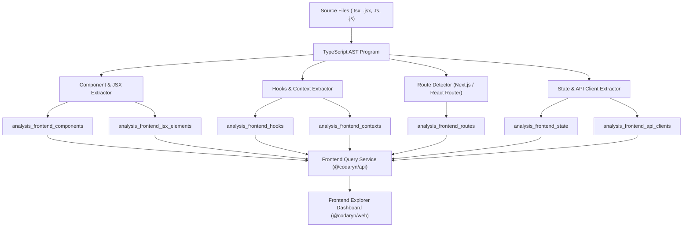

# Phase 6: Frontend architecture intelligence architecture

## Overview

Phase 6 implements the frontend architecture intelligence subsystem in Codaryn. It parses TypeScript and JavaScript source files into an Abstract Syntax Tree (AST), identifies React component structures, maps JSX rendering relationships, traces React hooks and state variables, indexes framework routing architectures (Next.js and React Router), and detects network requests initiated by frontend API clients.

## Core extractors in `@codaryn/frontend-analyzer`

### 1. React component detection (`components.ts`)
- **Functional components:** Identifies functions returning JSX elements, fragments, or null, whose identifiers begin with an uppercase letter. Supports `function` declarations, `const Comp = () => ...`, and `const Comp = function() ...`.
- **Higher-order component wrappers:** Detects `React.memo(Component)`, `React.forwardRef(...)`, and `React.lazy(...)`.
- **Class components:** Detects classes extending `React.Component` or `Component` implementing a `render()` method.
- **Props extraction:** Inspects the first parameter of functional components and generic arguments of class components. Extracts prop names, type literals, referenced interfaces/type aliases, and optional flags (`node.questionToken !== undefined`).
- **Export classification:** Categorizes components as `default`, `named`, or `internal`.

### 2. JSX rendering hierarchy (`components.ts`)
- Traverses the AST for `JsxOpeningElement` and `JsxSelfClosingElement`.
- Extracts the target component name.
- Captures attribute names passed as props.
- Identifies whether the element is conditionally rendered (nested inside `IfStatement`, `ConditionalExpression`, or `LogicalExpression` such as `condition && <Comp />`).
- Links child component references to their target component ID when resolvable within the repository.

### 3. Hook references & context provider tracking (`hooks-contexts.ts`)
- Detects calls to standard React hooks (`useState`, `useEffect`, `useContext`, `useReducer`, `useRef`, `useMemo`, `useCallback`) as well as custom hooks (`use*()`).
- Extracts dependency array expressions from `useEffect`, `useMemo`, and `useCallback`.
- Context detection:
  - Definition: Identifies `React.createContext(defaultValue)` calls.
  - Providers: Identifies JSX elements matching `<Context.Provider>` or `<*Provider>`.
  - Consumers: Identifies `useContext(Context)` calls and `<Context.Consumer>` elements.

### 4. Route detection & page mapping (`routes.ts`)
- **Next.js App Router:**
  - Evaluates file path conventions (`app/**/page.tsx`, `app/**/layout.tsx`).
  - Ignores route groups `(groupName)`.
  - Extracts dynamic parameters: `[id]` -> `id`, `[...slug]` -> `...slug`.
  - Computes canonical URL paths (e.g. `app/dashboard/settings/page.tsx` -> `/dashboard/settings`).
- **Next.js Pages Router:**
  - Evaluates file path conventions (`pages/**/index.tsx`, `pages/**/*.tsx`).
  - Converts dynamic parameters `[id]` to `:id`.
- **React Router:**
  - Analyzes `<Route path="..." element={<Component />} />` declarations.
  - Resolves path templates and linked components.

### 5. State management & API client calls (`state-api.ts`)
- **State management:**
  - Local state: `useState` and `useReducer` variable declarations and initial values.
  - Zustand: `create(...)` store definitions.
  - Redux: `useSelector` and `useDispatch` references.
  - TanStack Query: `useQuery({ queryKey: [...] })` calls and object destructuring.
- **API client calls:**
  - Fetch API: `fetch(endpoint, options)`.
  - Axios: `axios.get()`, `axios.post()`, `axios(config)`.
  - Custom clients: `apiClient.get()`, `api.post()`.
  - Target endpoint classification:
    - `isDynamic: false`: Literal string primitives (e.g. `"/api/v1/users"`).
    - `isDynamic: true`: String templates with expression interpolation (e.g. `` `/api/v1/users/${id}` ``).
    - Preserves boundary truth without speculative false linking.

## Relational database schema

Migration `0008_frontend_intelligence.sql` defines 7 dedicated relational tables indexed on `(job_id, ...)` for fast filtering and joins:
- `analysis_frontend_components`
- `analysis_frontend_jsx_elements`
- `analysis_frontend_hooks`
- `analysis_frontend_contexts`
- `analysis_frontend_routes`
- `analysis_frontend_state`
- `analysis_frontend_api_clients`

Foreign keys ensure cascading deletions when parent analysis jobs or components are removed.

## Workspace isolation & security

All backend API requests require `workspaceId` and `jobId`. `FrontendService.verifyJobAccess` confirms that the analysis job belongs to the authenticated user's active organization before executing database queries. Unauthorized access attempts across tenant boundaries are rejected with explicit error codes.
