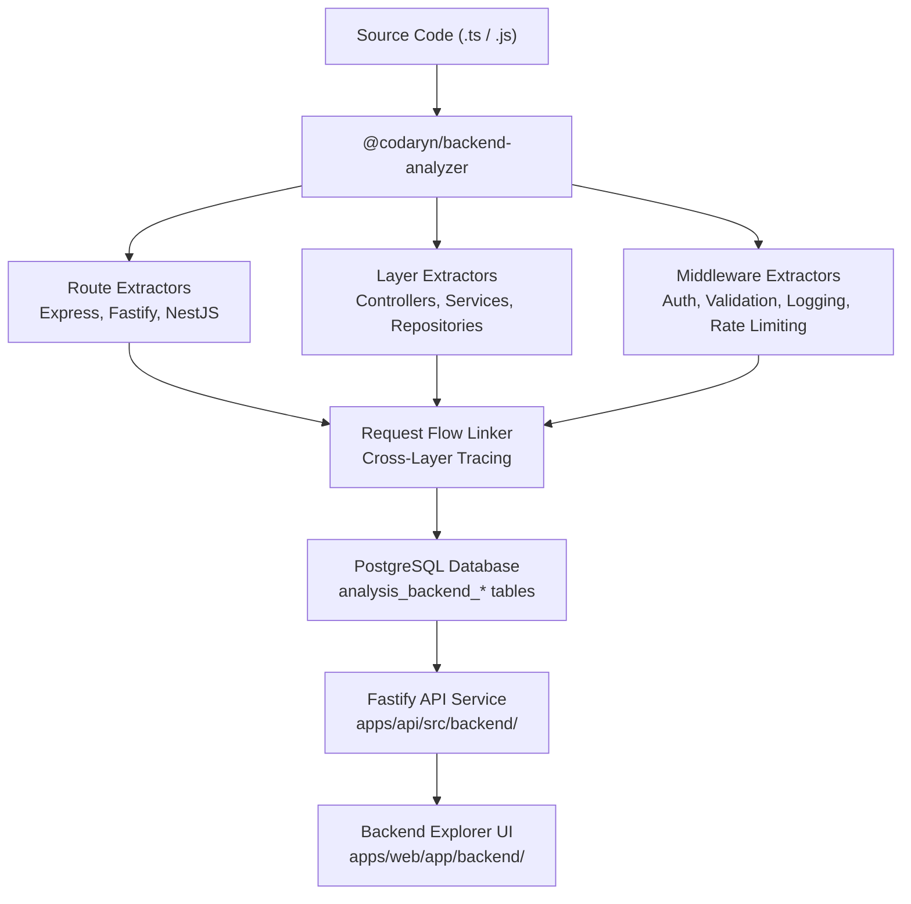

# Phase 7: Backend Architecture and API Intelligence

## Architectural Overview

Phase 7 introduces deep static analysis of backend Node.js and TypeScript services. It inspects server codebases using TypeScript ASTs to extract HTTP endpoints, controller declarations, service dependencies, repository persistence layers, middleware ordering, and request validation pipelines.

## Core Modules

### 1. Extractor Engine (`packages/backend-analyzer/`)
- `express-fastify.ts`: Analyzes Express routers, `app.use()` mount prefixes, route method invocations (`router.get()`, `router.post()`, etc.), Fastify plugin registrations, and `preHandler` hooks.
- `nestjs.ts`: Detects NestJS `@Controller()` classes and method decorators (`@Get()`, `@Post()`, `@Put()`, `@Delete()`, `@Patch()`), method parameters (`@Param()`, `@Body()`, `@Query()`), and guard/pipe annotations (`@UseGuards()`, `@UsePipes()`).
- `services-repositories.ts`: Scans class declarations, constructor parameters for dependency injection, and identifies ORM usage (Drizzle, Prisma, TypeORM, Kysely, raw SQL).
- `request-flow.ts`: Links routes with matching controllers, services, and repositories based on naming and call signatures. Identifies validation schemas (Zod, Joi, class-validator) and authentication mechanisms (JWT, session, guards).

### 2. Database Layer (`packages/database/`)
Six tables store the relational intelligence with `job_id` cascades:
- `analysis_backend_routes`: Extracted HTTP endpoints, methods, paths, framework, and dynamic flags.
- `analysis_backend_controllers`: Discovered controller classes with base routing paths.
- `analysis_backend_services`: Discovered service classes with methods and injected dependencies.
- `analysis_backend_repositories`: Data access layers classified by ORM type.
- `analysis_backend_middleware`: Middleware functions and guards categorized by kind and scope.
- `analysis_backend_request_flows`: End-to-end request pipelines linking routes to repositories.

### 3. Worker Pipeline (`workers/analysis/`)
The `backend` stage is integrated into `AnalysisProcessor` between `frontend` and `diagnostics`. It operates directly on TypeScript `SourceFile` objects in memory without executing repository code or installing untrusted dependencies.

### 4. REST API (`apps/api/`)
Endpoints in `apps/api/src/backend/` enforce tenant workspace isolation, query indexing, and return validated contract payloads.

### 5. Frontend Explorer (`apps/web/`)
A responsive Next.js dashboard at `/backend` providing:
- Endpoint Inventory with search, method badges, and framework filters.
- Layered Architecture explorer displaying Controller -> Service -> Repository connections.
- Middleware & Guards pipeline view.
- End-to-end Request Lifecycle visualizer.
- Detailed inspector pane for individual routes.
