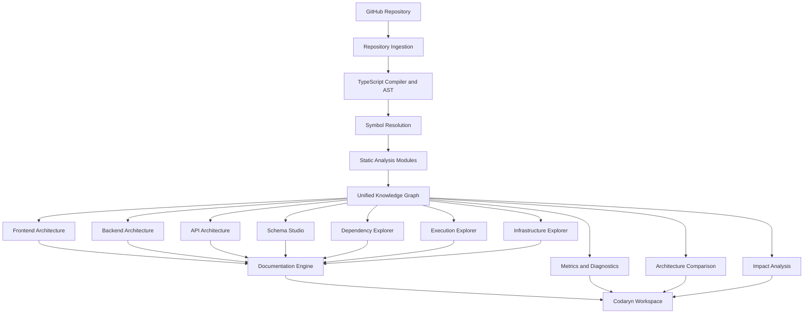
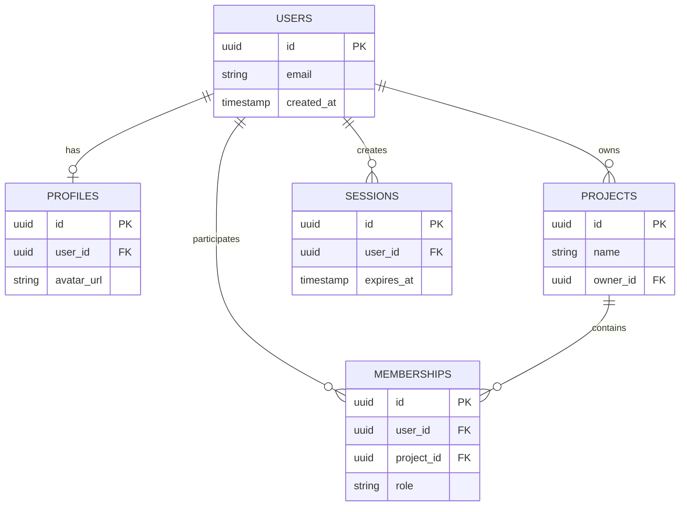

# codaryn
## Complete product architecture, feature specification and phased development blueprint

**Product category:** Code Intelligence and Software Architecture Platform  
**Product type:** GitHub-connected SaaS  
**Analysis model:** Deterministic static analysis, 100% LLM-free  
**Initial language:** TypeScript and JavaScript  
**Primary outputs:** Interactive architecture diagrams and technical documentation  
**Core differentiator:** Every visualization and explanation is connected to actual source-code evidence.

**Tagline:** Every connection, in view.

---

# 1. Product vision

## 1.1 What is codaryn?

codaryn is a software architecture intelligence platform that reconstructs the architecture of a software repository from its source code.

A developer connects GitHub, selects a repository, chooses what they want to analyze, and starts an analysis.

The platform then discovers:

- How the frontend is structured.
- How the backend is organized.
- How the frontend communicates with the backend.
- How API requests travel through the application.
- How services, controllers, functions and repositories connect.
- How database schemas are structured.
- How data moves between application layers.
- How external packages and services are connected.
- How the project is deployed.
- How tests cover application modules.
- How a code change could affect other parts of the system.

Instead of presenting all this information as disconnected reports, codaryn creates a unified architecture workspace.

Users can explore the entire system or focus on one specific area.

## 1.2 The problem

Understanding an unfamiliar codebase is difficult because architecture is usually distributed across source files, configurations, dependencies, database models and documentation.

A developer might understand the frontend but not the backend. They might understand the API but not know which database tables it touches.

Even when documentation exists, it might not represent the current source code.

codaryn solves this by automatically reconstructing the detectable architecture from the repository.

## 1.3 Product principles

| Principle | Product implementation |
|---|---|
| Evidence first | Every confirmed relationship links to source code |
| User-controlled | Users choose what they want to analyze |
| Connected | Every view uses the same canonical graph |
| Understandable | Complex structures are progressively revealed |
| Deterministic | Identical inputs and versions produce reproducible results |
| Secure | No repository scripts are executed during static analysis |
| Modular | Each analyzer is independently maintained |
| Version-aware | Every result belongs to a specific Git commit |
| Transparent | Unsupported and unresolved relationships are visible |

## 1.4 What codaryn is not

codaryn is not:

- An AI code-review chatbot.
- An LLM-based documentation generator.
- A generic Mermaid diagram generator.
- A code editor.
- An automated refactoring agent.
- A tool that guesses architectural relationships.
- A runtime debugger.

Its intelligence comes from AST parsing, type checking, symbol resolution, graph algorithms, static analysis and deterministic rules.

---

# 2. Brand and product identity

## Brand name: codaryn

**Pronunciation:** Koh-dar-in.

**Brand concept:** A modern code intelligence workspace that makes complex systems easier to understand.

### Visual identity

| Element | Direction |
|---|---|
| Wordmark | `codaryn` |
| Typography | Geist or Inter |
| Primary background | Warm white or deep charcoal |
| Accent | Electric indigo or cobalt |
| Secondary accent | Muted lime for positive analysis states |
| UI style | Minimal, precise, technical |
| Borders | Thin and subtle |
| Cards | Clean, low-radius or medium-radius surfaces |
| Motion | Short, functional transitions |
| Graphs | Distinct node categories with consistent visual language |

### Logo concept

A minimal geometric mark made of connected architectural nodes.

The mark should suggest:

- Connections.
- Layers.
- Structure.
- Flow.
- Relationships.

Avoid a literal brain, robot, AI sparkle, or complicated network illustration.

### Brand communication

Primary tagline:

**Every connection, in view.**

Supporting product description:

*An evidence-backed architecture map of your entire codebase.*

---

# 3. Product structure

codaryn should have five primary product areas.

| Product area | Purpose |
|---|---|
| Workspace | Manage organizations, repositories and analysis runs |
| Analysis Studio | Configure exactly what should be analyzed |
| Architecture Explorer | Explore the complete software architecture |
| Schema Studio | Explore database schemas, relations and data structures |
| Documentation Studio | Read, search and export generated documentation |

These areas must share a common repository and analysis context.

For example, when a developer opens a database table in Schema Studio, they should be able to navigate to the ORM model, repository methods, API endpoints and frontend fields connected to it.

---

# 4. User experience: Analysis Studio

This is one of the most important parts of the product.

Users must not be forced to run every analyzer every time.

Instead, codaryn should provide multiple ready-made analysis profiles and a customizable configuration wizard.

## 4.1 Analysis configuration journey

```text
Connect GitHub
      |
      v
Select Repository
      |
      v
Choose Branch / Commit
      |
      v
Select Analysis Profile
      |
      v
Choose Frontend / Backend / Database
      |
      v
Select Specific Analyzers
      |
      v
Choose Analysis Depth
      |
      v
Configure Output
      |
      v
Review Configuration
      |
      v
Start Analysis
      |
      v
Explore Results
```

## 4.2 Step 1: Repository selection

Frontend:

- GitHub connection screen.
- Repository cards and table view.
- Repository search.
- Private/public indicators.
- Organization selector.
- Branch selector.
- Commit selector.
- Monorepo root selector.
- Previous analysis indicator.

Backend:

- GitHub App installation management.
- Repository permission verification.
- Repository metadata retrieval.
- Branch and commit resolution.
- Commit SHA validation.
- Repository ownership validation.

User options:

- Analyze the default branch.
- Analyze a specific branch.
- Analyze a specific commit.
- Analyze selected monorepo applications.
- Analyze the entire repository.

## 4.3 Step 2: Choose what you want to understand

Show selectable visual cards.

Users can select multiple options.

| Profile | What the user gets | Included analyzers |
|---|---|---|
| Quick Overview | Project structure and technology overview | Repository, configuration, dependencies |
| Full Architecture | Complete supported architecture | All core analyzers |
| Frontend Deep Dive | Component and page relationships | React, routing, state, API clients |
| Backend Deep Dive | Services, routes and backend dependencies | Framework, controller, service and repository analyzers |
| API Explorer | API endpoints and request lifecycle | Route, middleware, handler, call graph |
| Database Explorer | Schema and application data relationships | ORM, SQL and schema analyzers |
| Schema Diagram Only | Database ERD and schema documentation | Schema analyzers |
| Dependency Analysis | Dependency paths and circular references | Module and package graph |
| Execution Flow | Functions and execution paths | Call graph, control flow |
| Infrastructure Review | Deployment and CI/CD configuration | Docker, workflows and infrastructure |
| Security Review | Static security findings | Security rules and dependency scanning |
| Testing Review | Test structure and test relationships | Testing analyzers |
| Change Impact | Potential impact of changes | Dependency graph and diff analysis |
| Custom Analysis | User-defined selection | Selected analyzers |

A user can select Full Architecture and then remove any analyzer they do not need.

### Presets

Provide:

- Quick Scan.
- Frontend Only.
- Backend Only.
- API and Database.
- Full System.
- Security Focus.
- Custom.

Users can save configurations as personal or organization-level presets.

## 4.4 Step 3: Frontend configuration

<front-end configuration options>

### Frontend analysis choices

| Option | Description |
|---|---|
| Project structure | Identify pages, components and application folders |
| Component hierarchy | Discover parent and child components |
| Component dependencies | Discover imported and referenced components |
| Routing architecture | Discover routes and route handlers |
| State management | Identify providers and state dependencies |
| Hooks analysis | Identify hooks and their relationships |
| Context analysis | Detect context providers and consumers |
| API integration | Map frontend API clients to backend endpoints where resolvable |
| Forms and validation | Detect schemas and validation patterns |
| Rendering patterns | Identify lazy imports and rendering relationships |
| Assets | Inventory assets and their references |
| Frontend configuration | Inspect build and environment configuration |

Initial framework detection:

- React.
- React Router.
- Next.js.
- Vite.
- Zustand.
- Redux.
- TanStack Query.
- React Hook Form.

Detection must remain version-aware and evidence-backed.

Users should be able to select:

- Auto-detect frameworks.
- Manually confirm detected frameworks.
- Exclude specific directories.
- Include or exclude tests.
- Analyze only selected application roots.

## 4.5 Step 4: Backend configuration

Backend analysis must be treated as a first-class area, not an extension of dependency analysis.

### Backend analysis choices

| Option | Description |
|---|---|
| Backend structure | Identify modules and service boundaries |
| Entry points | Discover application initialization and startup |
| API routes | Identify endpoints and HTTP methods |
| Middleware | Resolve recognized middleware chains |
| Controllers | Discover request handlers |
| Services | Discover business-service modules structurally |
| Repositories | Identify data access modules |
| Authentication | Detect authentication mechanisms and their locations |
| Authorization | Identify permission checks and evidence |
| Validation | Identify request validation schemas |
| Background jobs | Detect worker and queue handlers |
| Events | Discover event registrations and handlers |
| WebSockets | Detect supported socket registrations |
| External services | Identify external service integrations |
| Error handling | Identify error middleware and handling patterns |

### Backend framework choices

Initial adapters:

- Express.
- NestJS.
- Fastify.

Later:

- Hono.
- Koa.
- AdonisJS.
- Additional framework support based on demand.

The backend wizard should distinguish framework detection from user-selected analysis. Selecting Express analysis does not prove that a project is an Express application.

## 4.6 Step 5: Database and schema configuration

<badge color="success">Core product feature</badge>

This must have its own dedicated configuration section.

### Database source choices

| Source | Initial support |
|---|---|
| Prisma | Yes |
| Drizzle ORM | Yes |
| SQL DDL | Yes |
| SQL migrations | Yes |
| TypeORM | Later |
| Sequelize | Later |
| Mongoose | Later |
| OpenAPI schemas | Later |
| Zod schemas | Later |

### What users can select

- Database schema extraction.
- ER diagram generation.
- Table and column analysis.
- Primary key analysis.
- Foreign key analysis.
- Index analysis.
- Constraints.
- Enum definitions.
- Relationships.
- ORM model mapping.
- Query-to-table relationships.
- API-to-schema lineage.
- Schema comparison.
- Schema documentation.

### Schema output modes

1. Physical schema diagram.
2. ORM model diagram.
3. Application data model.
4. API contract schema.
5. Unified data lineage diagram.

These are different views. Do not merge all of them into one confusing diagram.

## 4.7 Step 6: Infrastructure and DevOps configuration

Users can select:

- Dockerfile analysis.
- Docker Compose analysis.
- GitHub Actions workflows.
- CI/CD dependency analysis.
- Environment configuration.
- Nginx configuration.
- Kubernetes manifests.
- Terraform infrastructure.
- Deployment relationships.
- External service configuration.

Initial implementation should prioritize Docker, Docker Compose and GitHub Actions.

## 4.8 Step 7: Analysis depth

Provide three levels.

| Level | Description | Use case |
|---|---|---|
| Overview | File structure, main dependencies, framework detection | Quick understanding |
| Standard | Symbols, module relationships, API and schema analysis | Most users |
| Deep | More intensive call graph, control flow and data flow analysis | Architecture investigations |

The platform must display which analyzers run at each level.

## 4.9 Step 8: Exclusions and privacy

Allow users to select:

- Exclude generated files.
- Exclude build folders.
- Exclude vendor directories.
- Exclude dependency directories.
- Exclude selected paths.
- Include test files.
- Include configuration files.
- Exclude documentation files.
- Respect `.gitignore`.
- Add custom ignore patterns.

The UI must clearly state:

**No LLM is used. Repository scripts are not executed during static analysis.**

Do not silently install dependencies or execute lifecycle scripts.

## 4.10 Step 9: Output selection

Users should choose what they actually want to generate.

### Diagrams

- System architecture.
- Frontend architecture.
- Backend architecture.
- API architecture.
- Database ERD.
- Module dependency graph.
- Function call graph.
- Execution flow.
- Infrastructure diagram.
- Testing structure.
- Change impact graph.

### Documentation

- Project overview.
- Architecture documentation.
- Frontend documentation.
- Backend documentation.
- API documentation.
- Schema documentation.
- Module documentation.
- Dependency documentation.
- Infrastructure documentation.
- Security findings.

### Export options

| Format | Use |
|---|---|
| SVG | High-quality diagrams |
| PNG | Quick sharing |
| PDF | Reports |
| Markdown | Documentation |
| Mermaid | Editable source diagrams |
| DBML | Database diagram interchange |
| JSON | Structured architecture data |

## 4.11 Step 10: Review and start

Before starting an analysis, show a configuration summary:

```text
Repository: acme / storefront
Branch: main
Commit: 8ac21f

Selected profiles:
  ✓ Full Architecture
  ✓ Frontend Deep Dive
  ✓ Backend Deep Dive
  ✓ Database Schema
  ✓ API Explorer

Analysis depth:
  Deep

Generated outputs:
  ✓ 8 diagrams
  ✓ 7 documentation sections
  ✓ Schema documentation
  ✓ Architecture report

Excluded:
  node_modules/
  dist/
  coverage/

Execution policy:
  Static analysis only
  No LLM
  No repository scripts
```

The user should be able to edit any section before starting.

---

# 5. Core product feature architecture

Every feature should belong to an actual module with a defined backend, frontend and analysis-engine contract.

## 5.1 Workspace and repository management

**Frontend**

- Workspace dashboard.
- Repository cards.
- Repository list.
- Repository search and filters.
- Recent analysis.
- Repository settings.
- Commit history.

**Backend**

- Organization management.
- Membership and roles.
- GitHub App installation.
- Repository synchronization.
- Branch and commit metadata.
- Access control.
- Audit events.

**Connected features**

Repository selection creates an analysis context. Every later screen uses that repository and its selected analysis snapshot.

## 5.2 Architecture Overview

This is the default landing page for a completed analysis.

Show:

- Project structure.
- Detected technology stack.
- Application boundaries.
- Frontend and backend relationships.
- Database connections.
- External dependencies.
- Major modules.
- Architecture metrics.
- Analysis coverage.
- Warnings and unresolved relationships.

**Frontend components**

- Architecture summary cards.
- Interactive graph.
- Layer filters.
- Module tree.
- Detail inspector.
- Source evidence panel.

**Backend components**

- Graph aggregation.
- Architecture classification.
- Overview metrics.
- Graph neighborhood queries.
- Snapshot retrieval.

## 5.3 Frontend Architecture Explorer

Show:

- Application entry points.
- Page structure.
- Routing.
- Component hierarchy.
- Context providers.
- Hooks.
- State management.
- API service connections.
- Rendering dependencies.

Illustrative structure:

```text
Application
  |
  +-- AuthProvider
  |
  +-- ThemeProvider
  |
  +-- Router
       |
       +-- LoginPage
       |     |
       |     +-- LoginForm
       |     +-- useAuth
       |
       +-- DashboardPage
             |
             +-- Sidebar
             +-- Analytics
             +-- UserTable
             +-- useDashboard
                    |
                    +-- DashboardAPI
```

Clicking `useAuth` should show its source, imported modules, callers, and any relationships that could be resolved.

## 5.4 Backend Architecture Explorer

Show:

- Server startup.
- Router registration.
- Controller/service relationships.
- Middleware.
- Authentication.
- Repositories.
- Database clients.
- Background jobs.
- External services.

Illustrative structure:

```text
HTTP Server
    |
    +-- Middleware
    |     |
    |     +-- Authentication
    |     +-- Request Validation
    |
    +-- Routes
          |
          +-- Auth Controller
          |      |
          |      +-- Auth Service
          |             |
          |             +-- User Repository
          |                    |
          |                    +-- PostgreSQL
          |
          +-- Billing Controller
                 |
                 +-- Billing Service
                        |
                        +-- Payment Provider
```

## 5.5 API Explorer

A separate API workspace.

Features:

- Endpoint inventory.
- HTTP methods.
- Route paths.
- Middleware chain.
- Controllers.
- Handler functions.
- Service relationships.
- Database operations.
- Authentication evidence.
- Request validation.
- Response paths where identifiable.
- OpenAPI specification detection.

### API execution view

A user opens `POST /api/auth/login`.

The system shows:

```text
POST /api/auth/login
       |
       v
validateLogin()
       |
       v
AuthController.login()
       |
       v
AuthService.authenticate()
       |
       v
UserRepository.findByEmail()
       |
       v
Prisma User Model
       |
       v
Database User Table
```

This is the key point: API architecture, backend architecture and database architecture must connect.

## 5.6 Database Schema Studio

<badge color="success">Dedicated primary workspace</badge>

Schema Studio deserves a separate navigation item.

It must not be hidden inside Backend Explorer.

### Main interface

```text
+-----------------------------------------------------------+
| Schema Studio     [Search] [Filter] [Layout] [Export]     |
+-------------------+---------------------------------------+
| DATABASE OBJECTS  |                                       |
|                   |          USER                         |
| Tables            |   +----------------------+            |
|                   |   | id          UUID PK  |            |
|  users            |   | email       VARCHAR  |            |
|  profiles         |   | created_at  TIMESTAMP|            |
|  projects         |   +----------------------+            |
|  memberships      |             |                         |
|  sessions         |             | 1 : 1                   |
|                   |             v                         |
|                   |          PROFILE                      |
|                   |   +----------------------+            |
|                   |   | id          UUID PK  |            |
|                   |   | user_id     UUID FK  |            |
|                   |   | avatar_url  TEXT     |            |
|                   |   +----------------------+            |
+-------------------+---------------------------------------+
| Selected: users | Evidence | Relations | Consumers        |
+-----------------------------------------------------------+
```

The above is an illustrative interface, not a schema derived from an actual repository.

### Schema capabilities

**Table visualization**

Each table card should show:

- Table name.
- Column count.
- Primary key.
- Foreign key indicators.
- Index count.
- Relationship count.

**Column visualization**

Show:

- Column name.
- Database type.
- Nullability.
- Primary key.
- Foreign key.
- Unique constraint.
- Default value.
- Index membership.
- Enum information.

**Relationship visualization**

Support:

- One-to-one.
- One-to-many.
- Many-to-many.
- Self-referencing relationships.
- Join tables.
- Identifying and non-identifying relationships where supported.

**Schema source traceability**

Clicking a table or column should show:

- ORM model.
- Migration file.
- SQL declaration.
- Source line.
- Related repository methods.
- Query references.

**Schema comparison**

Compare two commits or schema snapshots.

Detect:

- Added tables.
- Removed tables.
- Added columns.
- Removed columns.
- Type changes.
- Nullability changes.
- Default changes.
- New and removed indexes.
- Constraint changes.
- Relationship changes.

Flag potentially breaking changes using deterministic rules.

### Schema data lineage

This is a major differentiator.

Show how data moves across the application:

```text
Frontend Form
    |
    v
User TypeScript Interface
    |
    v
POST /api/users
    |
    v
CreateUserDTO
    |
    v
UserController
    |
    v
UserService
    |
    v
UserRepository
    |
    v
Prisma User Model
    |
    v
PostgreSQL users Table
```

Every edge should have:

- Relationship type.
- Evidence.
- Resolution status.
- Source file.
- Line number.

Do not claim that identical field names automatically prove data lineage. Use actual references, type mappings and query evidence, and mark heuristic matches as inferred.

### MongoDB schema support

For Mongoose and related supported schema definitions, show:

- Collections.
- Fields.
- Nested objects.
- Arrays.
- References.
- Enums.
- Required fields.
- Index declarations.

The diagram should distinguish document references from relational foreign keys.

### Schema exports

- SVG.
- PNG.
- PDF.
- DBML.
- Mermaid ER.
- JSON.
- Markdown.

Generating production migration SQL should remain a separate future capability with explicit review safeguards.

### Later extension

Add optional read-only live database introspection. It must be disabled by default, use least-privilege credentials and clearly distinguish actual deployed schemas from schemas inferred from Git.

## 5.7 Dependency Explorer

Features:

- File dependencies.
- Module dependencies.
- Package dependencies.
- Circular dependency detection.
- Strongly connected components.
- Dependency depth.
- Incoming and outgoing relationships.
- Most depended-upon modules.
- External package inventory.

## 5.8 Call Graph and Execution Explorer

Features:

- Function calls.
- Class method calls.
- Call hierarchy.
- Function entry and exit.
- Conditional paths.
- Loops and branches.
- Return relationships.
- Static data flow.
- Unresolved dynamic calls.

Provide different levels:

1. Function-level graph.
2. Module-level graph.
3. Request-level flow.
4. Cross-module execution flow.

Static analysis cannot always establish actual runtime behavior. The UI must identify uncertainty instead of making an inferred path appear guaranteed.

## 5.9 Infrastructure Explorer

Features:

- Docker architecture.
- Container definitions.
- Docker Compose services.
- Environment references.
- GitHub Actions.
- Deployment workflows.
- Infrastructure configuration.
- External services.
- Service dependencies.

## 5.10 Testing Explorer

Features:

- Test file inventory.
- Test framework detection.
- Test suites and cases.
- Tested module references.
- Mock dependencies.
- Test coverage ingestion where reports exist.
- Untested or unlinked modules where evidence is sufficient.

Do not invent test coverage when coverage reports are unavailable.

## 5.11 Security Explorer

Features:

- Hardcoded secret detection.
- Unsafe API patterns.
- Injection-related patterns.
- Risky dynamic execution.
- Configuration security checks.
- Dependency vulnerabilities through OSV.
- Optional Semgrep integration.
- Findings linked to actual source.

Each finding should provide:

- Severity.
- Rule identifier.
- Evidence.
- File and line.
- Explanation template.
- Remediation reference where available.
- Confidence classification.

## 5.12 Documentation Studio

Generate documentation from the canonical graph.

Sections:

- Project overview.
- Technology stack.
- Repository structure.
- Frontend architecture.
- Backend architecture.
- API reference.
- Schema documentation.
- Dependency documentation.
- Execution flow.
- Infrastructure.
- Security.
- Analysis limitations.

Users should be able to:

- Search.
- Navigate by module.
- Open source evidence.
- Export Markdown.
- Export PDF.
- Copy diagram source.
- Select a previous analysis snapshot.

Documentation must be generated using deterministic templates. It should not invent business explanations.

---

# 6. How all features connect

The most important architectural requirement is to prevent different parts of the product from generating separate, inconsistent interpretations of the same code.

## 6.1 Single source of truth

Use one unified Code Knowledge Graph.

Every analyzer contributes structured facts to this graph.

Every user-facing view is a projection of that graph.



## 6.2 Example of connected user experience

A user opens the frontend architecture and selects `CreateUserForm`.

The user can then:

1. Open its API client.
2. Navigate to the associated API endpoint if resolved.
3. Open the backend route.
4. Inspect the controller.
5. Follow the service call.
6. Open the repository method.
7. Navigate to the Prisma model.
8. Open the corresponding database table in Schema Studio.
9. Inspect the actual schema fields and their source declarations.
10. Open generated documentation for that entire flow.

No duplicated architecture model is required.

The same analysis snapshot powers every step.

---

# 7. Frontend architecture

## 7.1 Recommended stack

| Technology | Responsibility |
|---|---|
| React | User interface |
| TypeScript | Type safety |
| Vite | Frontend build |
| Tailwind CSS v4 | Styling |
| shadcn/ui | UI components |
| TanStack Query | Server state |
| Zustand | Graph and workspace UI state |
| React Router | Navigation |
| XYFlow / React Flow | Graph visualization |
| ELK.js | Graph layout |
| Zod | Frontend validation |
| React Hook Form | Analysis wizard |

## 7.2 Navigation structure

```text
codaryn
|
+-- Home
|
+-- Workspaces
|    |
|    +-- Overview
|    +-- Members
|    +-- Integrations
|
+-- Repositories
|    |
|    +-- Repository Overview
|    +-- Analysis Runs
|    +-- Branches
|    +-- Settings
|
+-- Architecture
|    |
|    +-- System Overview
|    +-- Frontend
|    +-- Backend
|    +-- API Explorer
|    +-- Schema Studio
|    +-- Dependencies
|    +-- Execution Flows
|    +-- Infrastructure
|    +-- Testing
|    +-- Security
|
+-- Documentation
|
+-- Comparisons
|
+-- Settings
```

## 7.3 Main dashboard

Show:

- Connected repositories.
- Recent analysis runs.
- Current analysis status.
- Architecture health metrics.
- Recent architecture changes.
- Saved views.
- Quick analysis actions.

Avoid putting every metric on the first screen.

The dashboard should answer three questions:

1. What repositories do I have?
2. What has been analyzed?
3. What should I inspect next?

## 7.4 Architecture interface layout

Use three main regions.

**Left panel**

- Architecture navigation.
- Search.
- Filters.
- Node categories.
- Saved views.

**Center canvas**

- Interactive graph.
- Zoom and pan.
- Graph layout.
- Relationship highlighting.
- Selection and path tracing.

**Right inspector**

- Selected node information.
- File location.
- Symbol metadata.
- Dependencies.
- Incoming relationships.
- Outgoing relationships.
- Source evidence.
- Related documentation.

The right inspector should update based on node selection without requiring a new page.

## 7.5 Understandability features

This is important because large architecture diagrams become confusing very quickly.

Implement:

- Progressive disclosure.
- Module grouping.
- Collapsible nodes.
- Search-first navigation.
- Relationship filters.
- Dependency path highlighting.
- Breadcrumbs.
- Overview minimaps.
- Source previews.
- Consistent node legends.
- Clear empty states.
- Loading states.
- Partial analysis states.

The user should be able to move from a high-level view to a detailed function graph without being overwhelmed.

## 7.6 Graph interaction requirements

- Click node to inspect.
- Double click to expand.
- Right click or context menu for actions.
- Search by symbol or filename.
- Highlight paths between two nodes.
- Hide selected relationship types.
- Group by folder, module or framework.
- Save graph layout.
- Reset layout.
- Export current diagram.
- Open source location.

Large graphs must use server-side neighborhood queries and progressive loading.

---

# 8. Backend architecture

## 8.1 Recommended stack

| Technology | Responsibility |
|---|---|
| Node.js | Backend runtime |
| TypeScript | Shared language |
| Fastify | REST API |
| Zod | Request and response validation |
| PostgreSQL | Persistent storage |
| Drizzle ORM | Database access |
| Redis | Cache and queue coordination |
| BullMQ | Background jobs |
| GitHub App | Repository integration |
| S3-compatible storage | Temporary and generated artifacts |
| OpenTelemetry | Observability |
| Docker | Isolated workers |

## 8.2 Backend modules

```text
backend/
|
+-- auth/
+-- users/
+-- organizations/
+-- memberships/
+-- github/
+-- repositories/
+-- branches/
+-- commits/
+-- analysis-profiles/
+-- analysis-runs/
+-- ingestion/
+-- analyzers/
+-- symbol-resolution/
+-- knowledge-graph/
+-- frontend-analysis/
+-- backend-analysis/
+-- api-analysis/
+-- schema-analysis/
+-- dependency-analysis/
+-- execution-analysis/
+-- infrastructure-analysis/
+-- testing-analysis/
+-- security-analysis/
+-- diagram-generation/
+-- documentation-generation/
+-- comparisons/
+-- webhooks/
+-- audit/
```

These are logical modules inside the control-plane application, not necessarily separate microservices.

Only the worker infrastructure should be independently scaled initially.

## 8.3 Worker architecture

```text
GitHub Webhook / User Request
             |
             v
       API Server
             |
             v
      Analysis Manifest
             |
             v
         BullMQ
             |
     +-------+--------+
     |       |        |
     v       v        v
 Ingestion  Static   Infrastructure
 Worker     Analysis Worker
                |
        +-------+-------+
        |       |       |
        v       v       v
     Frontend Backend Schema
     Analyzer  Analyzer Analyzer
        |       |       |
        +-------+-------+
                |
                v
       Unified Graph Builder
                |
         +------+------+
         |             |
         v             v
     Diagrams      Documents
         |             |
         +------+------+
                |
                v
         Result Storage
                |
                v
          Frontend API
```

## 8.4 Backend processing requirements

Every job must support:

- Idempotency.
- Retries.
- Stage tracking.
- Failure diagnostics.
- Cancellation.
- Resource limits.
- Progress reporting.
- Analyzer version tracking.
- Structured logging.
- Partial completion where safe.

Analysis must be immutable and associated with a specific commit SHA.

---

# 9. Analysis engine architecture

## 9.1 Core engine

The TypeScript Compiler API should be the primary parser and semantic analysis foundation for the initial language support.

Analysis pipeline:

1. Repository ingestion.
2. File classification.
3. Project and workspace detection.
4. TypeScript project discovery.
5. AST parsing.
6. Symbol extraction.
7. Module resolution.
8. Import and export analysis.
9. Dependency graph construction.
10. Framework detection.
11. Frontend analysis.
12. Backend analysis.
13. Database schema analysis.
14. Call graph construction.
15. Control flow and data flow analysis.
16. Knowledge graph construction.
17. Architecture rule execution.
18. Diagram and documentation generation.

## 9.2 Language and framework adapters

Create separate adapters for each supported framework and schema technology.

```typescript
export interface Analyzer {
  readonly id: string;

  supports(
    context: AnalyzerContext
  ): Promise<boolean>;

  analyze(
    context: AnalyzerContext
  ): Promise<AnalyzerResult>;
}
```

Initial TypeScript ecosystem:

| Area | Initial support |
|---|---|
| Language | TypeScript and JavaScript |
| Frontend | React |
| Routing | React Router, Next.js patterns |
| Backend | Express, NestJS, Fastify |
| ORM | Prisma, Drizzle |
| Schema | SQL DDL and migrations |
| Testing | Vitest, Jest |
| Infrastructure | Docker, Compose, GitHub Actions |

Detection must be based on source evidence, dependency metadata and configuration, not package names alone.

## 9.3 Unified knowledge graph

Node categories:

- Repository.
- Application.
- Package.
- File.
- Directory.
- Function.
- Method.
- Class.
- Interface.
- Component.
- Hook.
- Route.
- Controller.
- Service.
- Repository.
- Table.
- Column.
- Constraint.
- Index.
- External package.
- Infrastructure resource.
- Test suite.

Relationship categories:

- CONTAINS.
- IMPORTS.
- EXPORTS.
- CALLS.
- EXTENDS.
- IMPLEMENTS.
- RENDERS.
- USES.
- ROUTES_TO.
- MIDDLEWARE.
- READS_FROM.
- WRITES_TO.
- QUERIES.
- DEPENDS_ON.
- TESTS.
- CONFIGURES.

Every confirmed graph relationship must have evidence.

Every uncertain relationship must have an explicit resolution classification:

- DIRECT.
- RESOLVED.
- INFERRED.
- PARTIAL.
- UNRESOLVED.

---

# 10. Schema Studio technical design

## 10.1 Schema analysis model

The schema engine should create normalized representations for:

- Tables.
- Collections.
- Columns.
- Fields.
- Primary keys.
- Foreign keys.
- Indexes.
- Constraints.
- Enums.
- Relationships.
- Migrations.

Each object must retain its original source information.

## 10.2 Schema relationship model



This sample is a visualization fixture, not an asserted schema for any repository.

## 10.3 Backend schema endpoints

```text
GET /api/v1/analyses/:id/schemas

GET /api/v1/analyses/:id/schemas/:schemaId

GET /api/v1/analyses/:id/schemas/:schemaId/tables

GET /api/v1/analyses/:id/schemas/:schemaId/tables/:tableId

GET /api/v1/analyses/:id/schemas/:schemaId/relations

GET /api/v1/analyses/:id/schemas/:schemaId/lineage

GET /api/v1/analyses/:id/schemas/:schemaId/diff

GET /api/v1/analyses/:id/schemas/:schemaId/export
```

## 10.4 Database projections

Use normalized PostgreSQL projections tied to `analysis_run_id`.

Suggested tables:

- `schema_models`
- `schema_objects`
- `schema_fields`
- `schema_constraints`
- `schema_indexes`
- `schema_relationships`
- `schema_migrations`
- `schema_lineage`

These are derived representations of the canonical graph, not a second independent source of truth.

## 10.5 Schema correctness requirements

- Preserve native database types.
- Preserve nullability.
- Preserve defaults.
- Preserve constraints.
- Distinguish actual foreign keys from inferred references.
- Distinguish deployed-schema observations from repository declarations.
- Maintain source evidence.
- Support multiple schemas within a repository.
- Support schema snapshot comparisons.

---

# 11. User-facing analysis presets

Create an attractive preset selection screen.

The choices should be visually understandable before a user starts analysis.

| Preset | Main focus | Typical user |
|---|---|---|
| Overview | Understand the project quickly | New contributor |
| Complete System | All available architecture layers | Technical lead |
| Frontend Map | React and application structure | Frontend developer |
| Backend Map | Services and request handling | Backend developer |
| API Journey | Request-to-database flow | API developer |
| Schema Map | ERD and database relationships | Database engineer |
| Dependency Map | Module coupling and package usage | Architect |
| Security Map | Static security findings | Security engineer |
| Deployment Map | Infrastructure and CI/CD | DevOps engineer |
| Test Map | Test structure and coverage evidence | QA engineer |
| Change Impact | Potential effects of changes | Reviewer |
| Custom | User-selected modules | Advanced user |

### Preset behavior

Presets should be saved as versioned JSON configurations.

Example:

```json
{
  "name": "Backend and Database",
  "version": 1,
  "depth": "deep",
  "analyzers": {
    "repository": true,
    "symbols": true,
    "dependencies": true,
    "frontend": false,
    "backend": true,
    "api": true,
    "database": true,
    "schema": true,
    "callGraph": true,
    "controlFlow": false,
    "dataFlow": false,
    "infrastructure": false,
    "testing": false,
    "security": false
  },
  "outputs": {
    "systemDiagram": false,
    "backendDiagram": true,
    "apiDiagram": true,
    "schemaDiagram": true,
    "dependencyDiagram": true,
    "documentation": true
  }
}
```

The backend must validate the selected configuration and determine analyzer dependencies before enqueueing a job.

For example, API analysis depends on route discovery and relevant symbol resolution. It must not run when its required prerequisites have failed.

---

# 12. Complete frontend and backend connection map

| User action | Frontend | Backend | Analysis engine | Output |
|---|---|---|---|---|
| Connect GitHub | Connection UI | OAuth and App installation | None | Connected account |
| Select repository | Repository selector | GitHub API integration | Repository metadata | Repository workspace |
| Select profile | Analysis Studio | Profile validation | Analyzer selection | Validated manifest |
| Start analysis | Job progress view | Job orchestration | Repository ingestion | Analysis run |
| Open overview | Architecture dashboard | Graph aggregation | Architecture rules | System map |
| Open frontend | Frontend explorer | Graph query API | React analyzer | Component graph |
| Open backend | Backend explorer | Graph query API | Backend analyzer | Service graph |
| Open API | API explorer | Endpoint API | Route analyzer | API flow |
| Open schema | Schema Studio | Schema API | ORM and SQL analyzers | ERD |
| Open dependencies | Dependency explorer | Graph API | Dependency engine | Dependency graph |
| Open execution | Flow explorer | Graph API | Call and control flow engines | Execution graph |
| Export docs | Documentation UI | Export service | Template engine | Markdown/PDF |
| Compare commits | Comparison UI | Snapshot API | Diff and impact engine | Change report |

This mapping is a requirement. No feature should exist as a frontend-only mock or a backend endpoint with no product surface.

---

# 13. API architecture

All API responses must be scoped to the authenticated workspace and repository.

Recommended route structure:

```text
/api/v1
|
+-- /auth
+-- /organizations
+-- /members
+-- /github
+-- /repositories
+-- /branches
+-- /commits
+-- /analysis-profiles
+-- /analyses
+-- /architecture
+-- /frontend
+-- /backend
+-- /api-explorer
+-- /schemas
+-- /dependencies
+-- /execution-flows
+-- /infrastructure
+-- /testing
+-- /security
+-- /documents
+-- /comparisons
+-- /exports
+-- /webhooks
```

Use consistent error contracts, pagination, filtering, request validation and authorization.

Example analysis endpoint:

```http
POST /api/v1/repositories/{repositoryId}/analyses
```

Example request:

```json
{
  "commitSha": "8ac21f",
  "profileId": "backend-database-deep",
  "configuration": {
    "depth": "deep",
    "includeTests": true,
    "excludeGenerated": true
  }
}
```

Example response:

```json
{
  "analysisId": "analysis_123",
  "status": "queued",
  "commitSha": "8ac21f",
  "progress": 0
}
```

Use generated API contracts or shared TypeScript schemas so the frontend and backend cannot silently drift apart.

---

# 14. Database architecture

In addition to the existing core tables, introduce user configuration, schema and presentation models.

| Table | Purpose |
|---|---|
| users | User accounts |
| organizations | Workspaces |
| organization_members | Roles and membership |
| github_installations | GitHub App installations |
| repositories | Connected repositories |
| repository_branches | Branch metadata |
| repository_commits | Immutable commit references |
| analysis_profiles | Saved analyzer configurations |
| analysis_runs | Analysis snapshots |
| analysis_files | File inventory and parse status |
| architecture_nodes | Canonical graph nodes |
| architecture_edges | Canonical graph edges |
| architecture_evidence | Source references |
| analysis_diagnostics | Analyzer issues |
| analysis_metrics | Measured values |
| schema_models | Schema groupings |
| schema_objects | Tables, collections and similar objects |
| schema_fields | Columns and fields |
| schema_constraints | Schema constraints |
| schema_indexes | Database indexes |
| schema_relationships | Schema relations |
| schema_lineage | Data movement links |
| generated_diagrams | Generated diagrams |
| generated_documents | Documentation |
| saved_diagram_views | User-saved graph configurations |
| analysis_comparisons | Commit-to-commit comparisons |
| webhook_events | GitHub event processing |
| audit_logs | Security and activity trail |

All analysis-specific entities must reference the corresponding `analysis_run_id`.

A completed analysis is immutable. A new commit creates a new snapshot.

---

# 15. Complete phased development plan

The development plan is split into 14 phases.

Each phase has a clear frontend deliverable, backend deliverable, analysis deliverable and acceptance criteria.

A phase is not complete simply because its UI looks finished.

## Phase 0: Product foundation and system contracts

**Objective:** Establish the complete engineering foundation before feature implementation.

### Frontend

- Define design tokens.
- Create application shell.
- Create responsive navigation.
- Define typography and spacing system.
- Create shared UI components.
- Create graph node and edge design language.
- Define loading, error and empty states.
- Create reusable analysis configuration components.

### Backend

- Initialize Fastify application.
- Configure PostgreSQL.
- Configure Drizzle.
- Configure Redis.
- Configure BullMQ.
- Define authentication contracts.
- Define API response conventions.
- Establish environment configuration.
- Define shared Zod schemas.

### Analysis engine

- Create analyzer interfaces.
- Define graph node and edge contracts.
- Define evidence model.
- Define diagnostic model.
- Define analyzer versioning.
- Define graph identity strategy.

### Infrastructure

- pnpm workspace.
- Turborepo.
- Docker development environment.
- CI pipeline.
- Linting and type checking.
- Test infrastructure.

**Acceptance criteria**

- All applications build.
- Shared contracts compile.
- Database migrations run.
- Redis queues work.
- Workers can process a sample task.
- Frontend and API can communicate through validated contracts.

---

## Phase 1: Authentication and workspace management

**Objective:** Build the actual user and organization system.

### Frontend

- Sign-in page.
- GitHub sign-in.
- Account profile.
- Workspace creation.
- Workspace switching.
- Member management.
- Role management.
- Workspace settings.

### Backend

- User management.
- Session management.
- Organization CRUD.
- Organization membership.
- Role-based authorization.
- Workspace-scoped database queries.
- Audit event generation.

### Security

- Secure session handling.
- CSRF protection where applicable.
- Token storage encryption.
- Login rate limiting.
- Workspace access verification.

**Acceptance criteria**

- Users can create workspaces.
- Users can join or leave authorized workspaces.
- Roles are enforced by the API.
- One organization cannot access another organization's repositories.
- Workspace changes are auditable.

---

## Phase 2: GitHub connection and repository management

**Objective:** Allow users to securely connect and manage repositories.

### Frontend

- GitHub connection screen.
- Installation status.
- Repository grid.
- Repository table.
- Search and filters.
- Public/private badges.
- Branch selector.
- Commit selector.
- Repository settings.
- Disconnect integration flow.

### Backend

- GitHub App integration.
- Installation token handling.
- Repository listing.
- Branch retrieval.
- Commit retrieval.
- Permission validation.
- Webhook endpoint.
- Repository synchronization.
- Rate-limit handling.

### Ingestion worker

- Retrieve selected commit.
- Validate repository archive.
- Extract source into temporary workspace.
- Apply ignore rules.
- Build file inventory.
- Calculate content hashes.
- Detect monorepo boundaries.

### Security requirements

- No permanent raw GitHub installation tokens.
- No arbitrary repository scripts.
- No dependency lifecycle execution.
- Isolated ingestion storage.
- Cleanup after processing.

**Acceptance criteria**

- User can connect GitHub.
- Private repositories work with authorized access.
- User can choose a branch and commit.
- Repository ingestion returns a verified commit SHA.
- Repository contents are not exposed across workspaces.

---

## Phase 3: Analysis Studio and user configuration

**Objective:** Give users control over what the platform analyzes.

This phase is important because it determines the entire analysis workflow.

### Frontend

Build a complete multi-step Analysis Studio.

Screens:

1. Select repository.
2. Select branch and commit.
3. Select analysis profile.
4. Choose frontend analyzers.
5. Choose backend analyzers.
6. Choose database and schema analyzers.
7. Choose infrastructure analyzers.
8. Choose analysis depth.
9. Configure exclusions.
10. Choose diagrams.
11. Choose documents.
12. Review and start.

Additional features:

- Multi-selection.
- Preset cards.
- Analyzer descriptions.
- Required dependency indicators.
- Recommended configuration.
- Save custom presets.
- Duplicate presets.
- Reset to defaults.
- Configuration preview.

### Backend

- Analysis profile CRUD.
- Configuration validation.
- Analyzer compatibility validation.
- Dependency resolution.
- Configuration versioning.
- Configuration hashing.
- Analysis manifest creation.

### Analysis engine

Build an analyzer registry.

Each analyzer declares:

- ID.
- Version.
- Supported file types.
- Framework requirements.
- Dependencies.
- Configuration schema.
- Estimated resource category.

### Acceptance criteria

- Users can select multiple analysis modules.
- Invalid selections produce clear messages.
- Required analyzers are automatically added or explained.
- Saved presets can be reused.
- The backend validates all configuration independently of the frontend.
- The same configuration produces the same analysis manifest.

---

## Phase 4: TypeScript analysis foundation

**Objective:** Build the core static analysis engine.

### Frontend

- Analysis progress dashboard.
- Repository file inventory.
- Project structure explorer.
- File type summary.
- Parse error panel.
- Analyzer coverage indicators.
- Analysis stage timeline.

### Backend

- Analysis orchestration.
- Job creation.
- Job progress APIs.
- Job cancellation.
- Retry policies.
- Stage result persistence.
- Analyzer execution logs.

### Analysis engine

- TypeScript Compiler API integration.
- Compiler host.
- tsconfig discovery.
- Project reference handling.
- AST parser.
- Source file classification.
- Symbol extraction.
- Function extraction.
- Class extraction.
- Interface and type extraction.
- Import and export extraction.
- Diagnostics.

### Acceptance criteria

- TypeScript files parse correctly.
- TSX is supported.
- JavaScript within the project is supported.
- Multiple tsconfig files are handled.
- Parser errors do not crash entire runs.
- Every extracted symbol has source locations.
- Unsupported constructs are reported.

**Milestone:** A functioning TypeScript repository analyzer.

---

## Phase 5: Symbol resolution and dependency graph

**Objective:** Understand how source files and symbols connect.

### Frontend

- Dependency graph.
- File dependency view.
- Module dependency view.
- Incoming and outgoing dependency panels.
- Circular dependency warnings.
- Unresolved dependency panel.
- Source evidence inspector.
- Search and filters.

### Backend

- Graph persistence.
- Graph aggregation APIs.
- Node search.
- Edge search.
- Neighborhood queries.
- Graph pagination.
- Graph snapshot retrieval.

### Analysis engine

- TypeScript TypeChecker.
- Module resolution.
- Symbol resolution.
- Import/export mapping.
- Re-export handling.
- Circular dependency detection.
- Strongly connected components.
- Dependency depth.
- Module coupling metrics.

### Acceptance criteria

- Resolved imports link to actual source files.
- Symbols have stable identities.
- Circular dependencies are identified.
- Unresolved references remain visible.
- Every confirmed edge contains source evidence.
- Large graph queries are paginated.

**Milestone:** The first complete interactive code graph.

---

## Phase 6: Frontend architecture intelligence

**Objective:** Reconstruct the supported frontend architecture.

### Frontend

Build the Frontend Explorer with:

- Application overview.
- Component hierarchy.
- Page structure.
- Routing view.
- State management view.
- Hooks view.
- Context provider view.
- API client view.
- Component detail inspector.
- Search and path highlighting.

### Backend

- Frontend graph APIs.
- Component search.
- Component details.
- Rendering relationship endpoints.
- Route and hook query services.
- Component dependency queries.

### Analysis engine

- React component detection.
- JSX relationship extraction.
- Hook reference extraction.
- Context provider and consumer detection.
- Router detection.
- Route-to-page mapping.
- State management patterns.
- API client identification.
- Lazy import detection.

### Acceptance criteria

- Recognized components are indexed.
- Detected component references are linked.
- Page and route structures are visible.
- Hook and context relationships are traceable.
- API clients link to known backend endpoints only when evidence supports the mapping.

**Milestone:** Frontend architecture exploration.

---

## Phase 7: Backend architecture and API intelligence

**Objective:** Reconstruct backend organization and request handling.

### Frontend

Build the Backend Explorer.

Pages:

- Backend overview.
- Application startup.
- Module explorer.
- Controller explorer.
- Service explorer.
- Repository explorer.
- Middleware explorer.
- Authentication and authorization view.
- API endpoint inventory.
- Request lifecycle visualization.

### Backend

- Backend architecture API.
- Endpoint inventory API.
- Middleware chain API.
- Request flow API.
- Service and repository queries.
- Handler detail endpoints.

### Analysis engine

- Express route adapter.
- NestJS adapter.
- Fastify adapter.
- Controller and handler detection.
- Service pattern detection.
- Repository pattern detection.
- Middleware detection.
- Route mounting resolution.
- Request validation detection.
- Authentication pattern detection.

### Acceptance criteria

- Recognized routes are extracted.
- HTTP methods and paths are represented.
- Route handlers resolve where possible.
- Middleware order is represented where statically identifiable.
- Controller-to-service relationships are visible.
- Unresolved dynamic routing is clearly marked.

**Milestone:** Complete initial frontend and backend views.

---

## Phase 8: Schema Studio and database intelligence

**Objective:** Build the first-class schema diagram experience.

This phase must be prioritized ahead of optional advanced analysis features.

### Frontend

Build Schema Studio.

Screens:

- Schema overview.
- ERD canvas.
- Table browser.
- Table inspector.
- Column inspector.
- Relation inspector.
- Schema source panel.
- Schema filters.
- Schema layouts.
- Schema export.
- Schema documentation.
- Schema comparison.

### Backend

- Schema extraction result persistence.
- Schema object APIs.
- Table and field APIs.
- Constraint APIs.
- Relationship APIs.
- Schema lineage APIs.
- Schema comparison endpoints.
- Export endpoints.
- Schema search and pagination.

### Analysis engine

Initial support:

- Prisma.
- Drizzle.
- SQL DDL.
- SQL migrations.

Extraction:

- Tables.
- Columns.
- Types.
- Nullability.
- Defaults.
- Primary keys.
- Foreign keys.
- Unique constraints.
- Indexes.
- Enums.
- Relations.

Later adapters:

- TypeORM.
- Sequelize.
- Mongoose.

### Schema visualization

- One-to-one relationships.
- One-to-many relationships.
- Many-to-many relationships.
- Join tables.
- Self-relations.
- Relationship labels.
- Table grouping.
- Domain boundaries.
- Compact layouts.
- Full ER layouts.

### Schema integration

Connect:

```text
Frontend Field
    |
API Request Property
    |
Backend DTO
    |
Controller
    |
Service
    |
Repository
    |
ORM Model
    |
Schema Table / Column
```

Every connection needs direct or inferred evidence status.

### Acceptance criteria

- Prisma models generate ERD diagrams.
- Drizzle schema declarations generate ERD diagrams.
- Supported SQL DDL generates schema models.
- Table and column source locations are visible.
- Foreign keys are correctly represented.
- Inferred relations are visually distinct.
- Schema diagrams can be exported.
- Schema documents reference the same schema snapshot.
- Schema comparison detects supported structural changes.

**Milestone:** A real, connected Schema Studio.

---

## Phase 9: Call graphs, execution and data flow

**Objective:** Make internal code execution easier to understand.

### Frontend

- Function call graph.
- Function inspector.
- Execution path viewer.
- Branch and decision visualization.
- Data flow explorer.
- Entry-point explorer.
- Path search.
- Unresolved call inspector.

### Backend

- Call graph query service.
- Path traversal API.
- Function neighborhood API.
- Data flow retrieval API.
- Execution graph aggregation.

### Analysis engine

- Direct call resolution.
- Method resolution.
- Constructor references.
- Callback references.
- Control flow graphs.
- Return relationships.
- Initial intraprocedural data flow.
- Framework-aware entry-point discovery.

### Acceptance criteria

- Resolved calls link to real symbols.
- Call paths can be displayed.
- Branches and loops are represented.
- Dynamic calls remain unresolved where necessary.
- The interface distinguishes potential paths from guaranteed runtime behavior.

**Milestone:** Detailed code execution exploration.

---

## Phase 10: Infrastructure, testing and security intelligence

**Objective:** Understand the operational architecture around the application.

### Frontend

- Infrastructure explorer.
- Docker architecture.
- CI/CD workflow viewer.
- Environment configuration view.
- Testing explorer.
- Test-to-module relationships.
- Security dashboard.
- Finding detail inspector.

### Backend

- Infrastructure analysis APIs.
- Testing result APIs.
- Security diagnostics APIs.
- OSV result storage.
- Finding filtering and grouping.
- Audit and severity management.

### Analysis engine

Infrastructure:

- Dockerfile.
- Docker Compose.
- GitHub Actions.

Testing:

- Vitest.
- Jest.
- Test-to-symbol relationships.
- Coverage report ingestion.

Security:

- Hardcoded credential rules.
- Dangerous function patterns.
- Configuration rules.
- Semgrep integration.
- OSV Scanner integration.

### Acceptance criteria

- Infrastructure resources are extracted from configuration.
- CI/CD workflows are represented.
- Tests link to supported source symbols.
- Security findings contain evidence.
- Unsupported security cases are disclosed.
- Dependency vulnerability results distinguish declared versions from resolved lockfile versions.

**Milestone:** Operational architecture and engineering quality views.

---

## Phase 11: Diagram and documentation system

**Objective:** Make every analysis output understandable, exportable and connected.

### Frontend

- Diagram workspace.
- Documentation workspace.
- Search across generated documents.
- Source links.
- Saved diagrams.
- Export interface.
- Markdown preview.
- Diagram legends.
- Layout controls.

### Backend

- Diagram generation jobs.
- Graph serialization.
- Layout configuration storage.
- Document template execution.
- Export processing.
- Artifact storage.
- Document versioning.

### Analysis engine

- System architecture renderer.
- Frontend architecture renderer.
- Backend architecture renderer.
- API architecture renderer.
- ERD renderer.
- Dependency graph renderer.
- Execution flow renderer.
- Infrastructure renderer.
- Documentation template registry.

### Acceptance criteria

- All outputs use the same analysis snapshot.
- Every confirmed architecture claim has supporting evidence.
- Diagrams can be exported.
- Documentation can be exported.
- Saved layouts remain available.
- Generated documents carry analyzer and commit metadata.

**Milestone:** Complete architecture and documentation workspace.

---

## Phase 12: Incremental analysis, comparison and impact

**Objective:** Keep architecture synchronized with GitHub changes.

### Frontend

- Commit comparison.
- Architecture diff view.
- Added and removed nodes.
- Changed relationships.
- Schema diff view.
- Change impact explorer.
- Analysis history.
- Snapshot selection.

### Backend

- GitHub webhook processing.
- Commit comparison service.
- Incremental job scheduling.
- Snapshot comparison API.
- Graph version management.
- Impact result persistence.

### Analysis engine

- Changed file detection.
- File hash comparison.
- Dependency invalidation.
- Affected symbol detection.
- Selective analyzer execution.
- Graph reconciliation.
- Architecture drift rules.

### Acceptance criteria

- New commits trigger configured analysis.
- Unchanged files reuse compatible cached results.
- Changed files are reprocessed.
- Affected modules are identified.
- Historical snapshots remain immutable.
- Incremental results can be checked against a full analysis.

**Milestone:** Version-aware architecture intelligence.

---

## Phase 13: Collaboration, administration and exports

**Objective:** Turn codaryn into a usable team platform.

### Frontend

- Organization dashboard.
- Member management.
- Role management.
- Saved diagram views.
- Shared architecture links.
- Export center.
- Activity timeline.
- Workspace configuration.

### Backend

- Fine-grained permissions.
- Shared resource access.
- Signed export links.
- Audit logs.
- Usage tracking.
- Organization-level analysis presets.
- Retention controls.

### Acceptance criteria

- Users can share permitted repository analysis.
- Roles are enforced at API level.
- Shared resources cannot expose unauthorized private code.
- Exports are scoped to their analysis snapshots.
- All relevant administrative activity is auditable.

---

## Phase 14: Performance, security and production launch

**Objective:** Make the product dependable.

### Frontend

- Graph rendering optimization.
- Search optimization.
- Responsive layouts.
- Accessibility testing.
- Error boundaries.
- Offline-friendly static documentation where appropriate.
- Performance monitoring.

### Backend

- Load testing.
- Queue stability testing.
- Database index optimization.
- API rate limiting.
- Backup and recovery.
- Observability.
- Error monitoring.
- Retention enforcement.

### Analysis engine

- Golden repository tests.
- Parser benchmarks.
- Symbol resolution benchmarks.
- Graph accuracy tests.
- Analyzer regression tests.
- Large repository tests.
- Memory profiling.

### Acceptance criteria

- No cross-workspace data access.
- No repository script execution in ordinary static analysis.
- Large graph navigation remains responsive through progressive loading.
- Analysis jobs recover from worker failures.
- Full analysis can recover from incremental-analysis inconsistencies.
- Backup restoration is tested.
- Security review is completed.

---

# 16. Release strategy

Do not release all features together.

Use three product milestones.

## Alpha: Core code intelligence

Includes:

- GitHub.
- Repository ingestion.
- Analysis Studio.
- TypeScript parsing.
- Symbol extraction.
- Dependency graph.
- Source evidence.

**Success condition:** Users can connect a TypeScript repository and inspect a reliable source-linked dependency graph.

## Private beta: Full architecture workspace

Includes:

- Frontend Explorer.
- Backend Explorer.
- API Explorer.
- Schema Studio.
- ERD exports.
- Documentation Studio.
- Infrastructure analysis.
- Testing and security views.

**Success condition:** A user can understand the major architecture layers of a supported TypeScript project without manually tracing every file.

## Public v1: Continuously updated code intelligence

Includes:

- Incremental analysis.
- Schema diffs.
- Architecture diffs.
- Change impact.
- Saved views.
- Collaboration.
- Production hardening.

**Success condition:** Teams can use codaryn repeatedly to understand both the current architecture and how it changes over time.

---

# 17. Technical architecture and monorepo structure

Recommended organization:

```text
codaryn/
│
├── apps/
│   ├── web/
│   │   ├── src/
│   │   │   ├── app/
│   │   │   ├── components/
│   │   │   ├── features/
│   │   │   │   ├── dashboard/
│   │   │   │   ├── repositories/
│   │   │   │   ├── analysis-studio/
│   │   │   │   ├── architecture/
│   │   │   │   ├── frontend-explorer/
│   │   │   │   ├── backend-explorer/
│   │   │   │   ├── api-explorer/
│   │   │   │   ├── schema-studio/
│   │   │   │   ├── dependency-explorer/
│   │   │   │   ├── execution-explorer/
│   │   │   │   ├── security/
│   │   │   │   ├── infrastructure/
│   │   │   │   ├── documentation/
│   │   │   │   └── comparisons/
│   │   │   ├── hooks/
│   │   │   ├── stores/
│   │   │   └── lib/
│   │   └── package.json
│   │
│   └── api/
│       └── src/
│           ├── modules/
│           ├── plugins/
│           ├── middleware/
│           ├── routes/
│           └── server.ts
│
├── workers/
│   ├── ingestion/
│   ├── analysis/
│   ├── webhook/
│   ├── comparison/
│   └── export/
│
├── packages/
│   ├── contracts/
│   ├── shared-types/
│   ├── database/
│   ├── github/
│   ├── repository-ingestion/
│   ├── file-classifier/
│   ├── compiler/
│   ├── ast/
│   ├── symbols/
│   ├── resolution/
│   ├── graph/
│   ├── analyzers/
│   │   ├── frontend/
│   │   ├── backend/
│   │   ├── api/
│   │   ├── schema/
│   │   ├── infrastructure/
│   │   ├── testing/
│   │   └── security/
│   ├── architecture-rules/
│   ├── diagram-engine/
│   ├── documentation-engine/
│   └── export-engine/
│
├── fixtures/
│   └── repositories/
│
├── infrastructure/
│   ├── docker/
│   ├── postgres/
│   └── redis/
│
├── docs/
│
├── package.json
├── pnpm-workspace.yaml
├── turbo.json
└── docker-compose.yml
```

Keep the control plane modular. Do not turn every analyzer into a microservice. Scale workers according to resource demand.

---

# 18. Frontend design direction

The product should feel like a premium developer workspace, not a crowded enterprise administration panel.

## Design principles

- Minimal visual noise.
- Clear information hierarchy.
- Strong typography.
- Neutral backgrounds.
- One restrained accent.
- Consistent iconography.
- Compact but readable information density.
- Helpful interactions.
- No unnecessary animated backgrounds.
- No excessive gradients or glowing effects.

## Recommended design system

| Component | Direction |
|---|---|
| Main shell | Minimal sidebar + content workspace |
| Graph workspace | Large interactive canvas |
| Cards | Subtle borders |
| Inspector | Structured metadata panel |
| Tables | Dense but readable |
| Dialogs | Short and task-focused |
| Wizard | Step-based configuration |
| Status | Neutral, success, warning, error |
| Code previews | Monospace and line numbers |

## Suggested color direction

| Token | Light | Dark |
|---|---|---|
| Background | `#FAFAFA` | `#0C0D10` |
| Surface | `#FFFFFF` | `#14161B` |
| Primary text | `#17191F` | `#F4F5F7` |
| Secondary text | `#737783` | `#969BA8` |
| Border | `#E7E8EC` | `#282B33` |
| Accent | `#635BFF` | `#8A83FF` |
| Success | `#168A62` | `#42BD8B` |
| Warning | `#B7791F` | `#E6AD56` |
| Error | `#C44444` | `#F07474` |

Make dark mode and light mode equally complete.

---

# 19. Testing and quality gates

Every feature phase must include frontend and backend testing.

## Frontend testing

- Component tests.
- Analysis wizard flow tests.
- Graph interaction tests.
- Accessibility checks.
- API loading and failure tests.
- Permission-based rendering tests.
- Export interaction tests.

## Backend testing

- API integration tests.
- Authorization tests.
- Database constraint tests.
- Queue retry tests.
- Webhook verification tests.
- Multi-tenant isolation tests.
- Job cancellation tests.

## Analysis testing

Create controlled fixture repositories.

```text
fixtures/
├── react-basic/
├── react-router/
├── express-basic/
├── nestjs-basic/
├── fastify-basic/
├── prisma-basic/
├── drizzle-basic/
├── sql-migrations/
├── typescript-monorepo/
├── circular-dependencies/
├── dynamic-imports/
├── callback-heavy/
└── mixed-frontend-backend/
```

Every fixture should have expected graph output.

Measure:

- Symbol resolution accuracy.
- Dependency edge precision.
- Schema extraction accuracy.
- Relationship evidence coverage.
- Framework detection precision.
- Unresolved relationship rate.
- Analysis duration.
- Memory usage.

Never optimize for graph size at the expense of correctness.

---

# 20. Security and privacy requirements

Because codaryn analyzes private source code, security must be part of the initial architecture.

Required controls:

1. GitHub App with minimum permissions.
2. Short-lived installation tokens.
3. Encrypted credentials.
4. Strict organization isolation.
5. Ephemeral analysis workspaces.
6. No privileged analysis containers.
7. No host filesystem access from repository workers.
8. No Docker socket mounting.
9. Restricted outbound network access.
10. CPU, RAM and time limits.
11. Archive extraction safeguards.
12. Secret redaction.
13. Source deletion and retention settings.
14. Signed download URLs.
15. Full analysis audit logs.

The static analysis environment must not run `npm install`, lifecycle scripts, build scripts or arbitrary code from a repository.

---

# 21. Product feature prioritization

Use the following prioritization.

| Feature | Priority | Release |
|---|---|---|
| GitHub integration | P0 | Alpha |
| Repository management | P0 | Alpha |
| Analysis Studio | P0 | Alpha |
| TypeScript parsing | P0 | Alpha |
| Symbol extraction | P0 | Alpha |
| Dependency graph | P0 | Alpha |
| Source evidence | P0 | Alpha |
| Frontend Explorer | P0 | Beta |
| Backend Explorer | P0 | Beta |
| API Explorer | P0 | Beta |
| Schema Studio | P0 | Beta |
| ERD generation | P0 | Beta |
| Documentation Studio | P0 | Beta |
| Infrastructure Explorer | P1 | Beta |
| Testing Explorer | P1 | Beta |
| Security Explorer | P1 | Beta |
| Call graph | P1 | Beta |
| Schema comparison | P1 | V1 |
| Architecture comparison | P1 | V1 |
| Incremental analysis | P1 | V1 |
| Change impact | P1 | V1 |
| Collaboration | P2 | V1 |
| Cross-repository mapping | P2 | Future |

---

# 22. Final product definition

codaryn should be built as one connected product with four central principles:

**1. The user decides what to analyze.**

Multiple presets, custom selections, depth settings, framework choices and output controls.

**2. The frontend and backend are equally important.**

Both must have dedicated explorers, analyzers, APIs and documentation.

**3. Schema Studio is a first-class feature.**

Database tables, columns, relationships, constraints, indexes, ORM models, lineage and schema comparisons.

**4. Everything shares one evidence-backed graph.**

Architecture diagrams, documentation, APIs, schema diagrams and impact reports must use the same immutable analysis snapshot.

The strongest version of codaryn is not a diagram generator. It is a technical workspace that lets developers navigate a complete software system without having to manually reconstruct its architecture.

## Definition of a successful v1

A developer should be able to connect a real GitHub repository, choose Full Architecture or a custom analysis profile, inspect the frontend, backend, API and database schema, navigate relationships between them, trace every confirmed relationship to source code, and export the resulting technical documentation.

All without using an LLM.

**codaryn**

*Every connection, in view.*